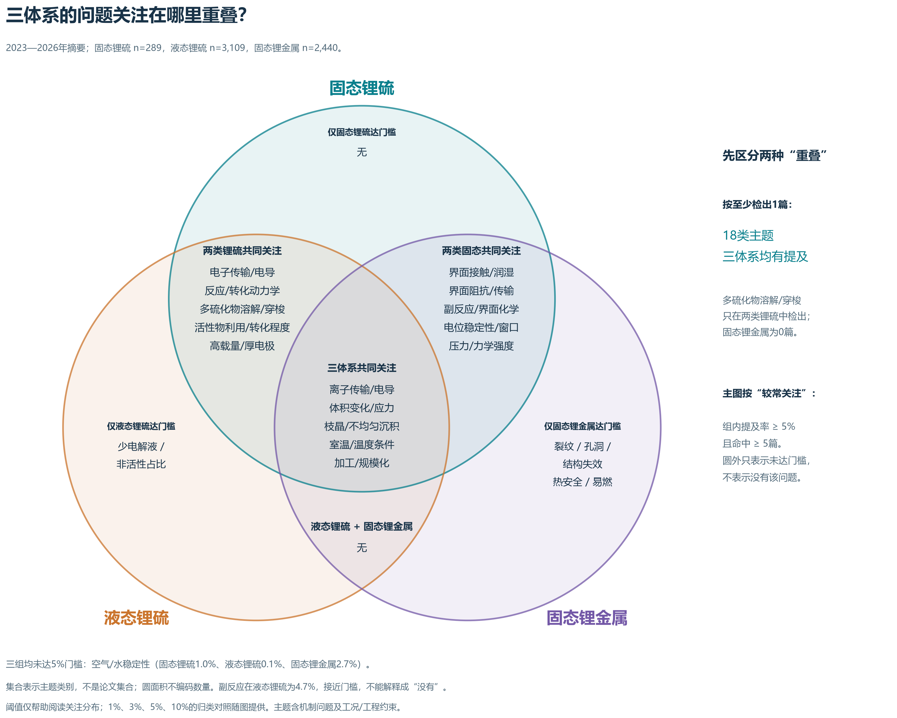
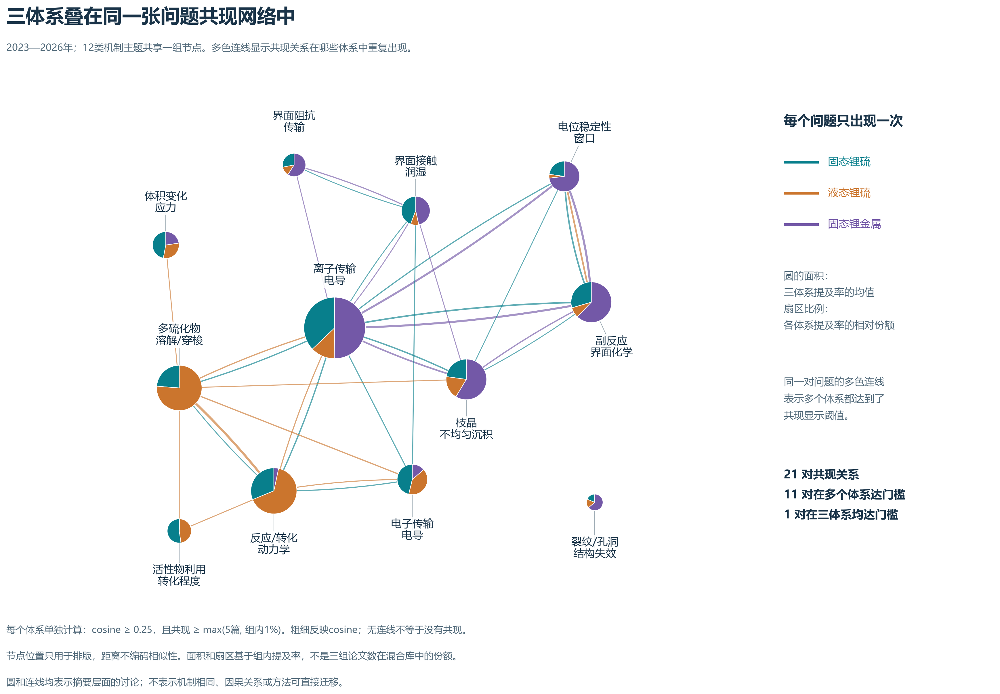
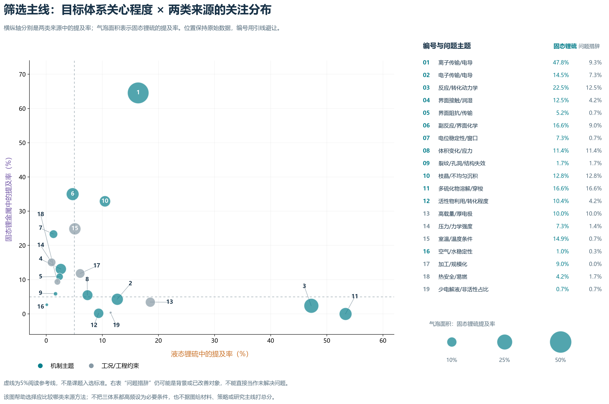

# 三体系综合关系图：读图与选题用途

沿用既有2023—2026年摘要统计：固态锂硫289篇、液态锂硫3,109篇、固态锂金属2,440篇。本轮只重构图形与比较方式，没有重跑文献抽取或改变问题标签。

## 1. 一张重叠图：哪些体系较常关注同一个问题？

**按是否检出，19类主题中18类在三组均出现；只有“多硫化物溶解/穿梭”在本次固态锂金属子集中为0篇。** 这不证明该主题永远不会出现在固态锂金属相关论文中。

因此主图按“组内提及率至少5%，且至少5篇”区分较常关注的区域。图中的独区只表示“仅该体系达到门槛”，不表示该问题为其独有；圆面积不代表论文数或主题数。

|达到门槛的体系|主题|
|---|---|
|固态锂硫 + 液态锂硫 + 固态锂金属|离子传输/电导；体积变化/应力；枝晶/不均匀沉积；室温/温度条件；加工/规模化|
|固态锂硫 + 液态锂硫|电子传输/电导；反应/转化动力学；多硫化物溶解/穿梭；活性物利用/转化程度；高载量/厚电极|
|固态锂硫 + 固态锂金属|界面接触/润湿；界面阻抗/界面传输；副反应/界面化学；电位稳定性/窗口；压力/力学强度|
|液态锂硫 + 固态锂金属|无|
|固态锂硫|无|
|液态锂硫|少电解液/非活性占比|
|固态锂金属|裂纹/孔洞/结构失效；热安全/易燃|
|三组均未达门槛|空气/水稳定性|

**门槛附近的主题尤其需要看原比例。** 例如副反应在液态锂硫为4.7%，室温/温度条件为5.1%；不能用一条5%线将它们解释为物理上的不存在或存在。1%、3%、5%、10%的结果见“主题重叠及阈值敏感性.csv”。

## 2. 一张共享网络：共现关系在哪些体系重复出现？

每个机制主题只有一个节点。扇区颜色沿用三体系配色；节点总面积对应三组提及率的均值，扇区对应三组提及率的相对份额，避免大组文献数量压过小组。连线是同一体系内部的论文共现；同一对问题的多色线表示多个体系都达到显示门槛。

显示规则统一为cosine ≥ 0.25，且共现篇数 ≥ max(5,该组文献数的1%)。为了让三组网络叠在一图后仍可阅读，较前版单体系图提高了cosine显示门槛，但原始计数没有改变。未达到门槛不表示没有共现。

本图有21对关系，其中11对在两个及以上体系达门槛，1对在三体系均达门槛。典型关系如下：

|共现关系|达到显示门槛的体系|
|---|---|
|离子输运—反应/转化动力学|固态锂硫、液态锂硫|
|电子输运—反应/转化动力学|固态锂硫、液态锂硫|
|离子输运—界面接触|固态锂硫、固态锂金属|
|界面接触—界面阻抗|固态锂硫、固态锂金属|
|副反应/界面化学—电位稳定性|三体系|

**这些是共现关系的重叠，不是因果边。** 最后一对也存在词义邻近，不能因此称其为最有创新性的主线。网络布局只是共同的图形布局，不证明机制聚类。

## 3. 一张来源气泡图：选定问题后，优先比较哪类文献？

横轴为液态锂硫关注比例，纵轴为固态锂金属关注比例，气泡面积为固态锂硫关注比例。读图时先看目标体系的大气泡，再看它靠近哪类来源，最后回读摘要/全文判断具体限制与作用位置。右侧附目标体系的提及率与问题措辞比例，避免把常规性能报告误读为未解决问题。

- 转化动力学：固态锂硫22.5%、液态锂硫47.2%、固态锂金属2.4%。适合优先比较硫反应调控方法；不要求固态锂金属也把“硫转化”列为热点。
- 离子传输：固态锂硫47.8%、液态锂硫16.4%、固态锂金属64.6%。适合比较固态输运方法，但其中包含电导测量与改善结果，不能直接把最高词频定成核心瓶颈。
- 接触：固态锂硫12.5%、液态锂硫2.6%、固态锂金属13.1%。适合比较固态接触处理方法，仍要核对发生在正极、负极还是电解质内部。

对当前选题，图形支持继续比较“固态硫转化动力学受限”这条候选主线及其限制来源。它没有把某个材料、组合或双变量实验选出来。接触、输运、副反应可以是同一主问题的候选原因，也可能是独立备选问题，需要全文证据来取舍。

## 使用建议与文件

汇报时先用重叠图讲三体系的关系，再用共享网络展示共同讨论的关系，最后用来源气泡图解释为什么选择某个问题去比较方法。三图分工不同，不必用复杂网络替代全部论证。

已提供PNG、可编辑SVG、GraphML以及对应CSV。原统计的检索倾向、摘要缺失、自动分组、正负极位置混合和语义误判限制仍然适用；本轮没有完成独立的全库人工验证。

图中“重叠”与“仅某体系达到门槛”均为本地语料、特定词表和显示门槛下的结果。