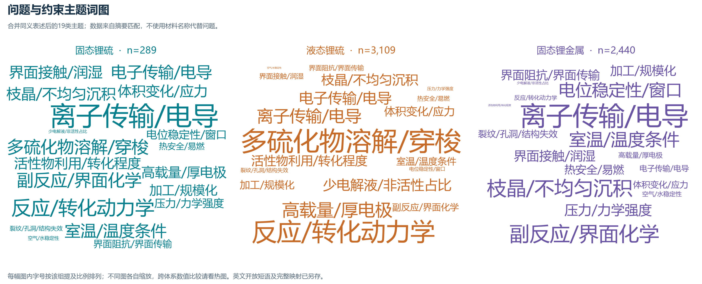
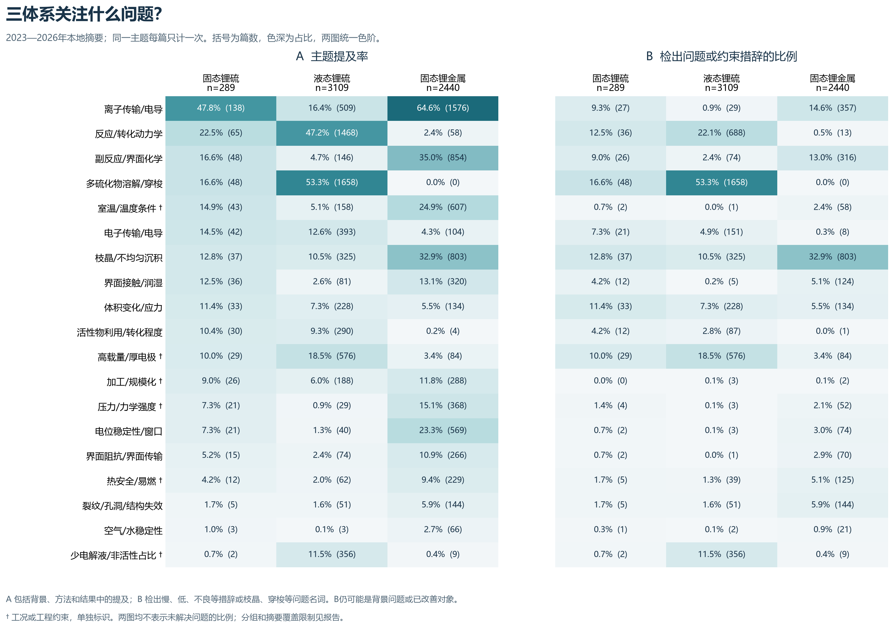
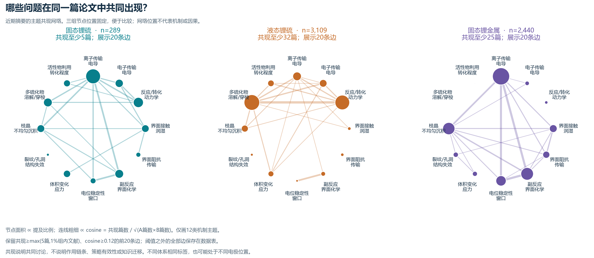
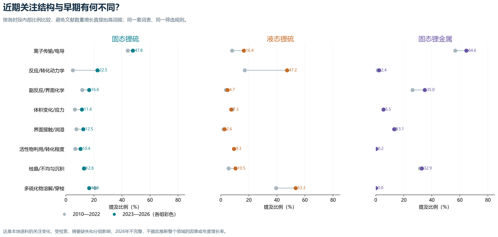

# 三体系问题词图、共现网络与主线筛选

分析日期：2026-10-19。对象为现有本地文献库；“近期”统一指2023—2026年，2026年尚不完整。

## 先回答研究问题

**建议把“固态锂硫正极中硫转化动力学受限”作为下一阶段的方法比较主线。**

这是基于关注分布、跨体系重叠和摘要证据作出的研究优先级判断，并非词频已经证明某一种机制。目标是解释并改善硫转化慢；离子输运、电子输运、接触和界面反应是需要逐一检验的限制来源。不能把它们直接拼成多个并行课题，也不能据本次统计直接选定材料。

选择这条主线的依据如下：

1. 在近期固态锂硫主集中，反应/转化动力学有65篇提及（22.5%），其中36篇检出动力学慢或反应障碍等问题措辞；严格分组子集仍有53篇提及、32篇检出问题措辞。这不是由几篇材料论文拼出的假设。
2. 与液态锂硫的重叠主要在转化动力学、电子输运、活性物利用；与固态锂金属的重叠主要在离子输运、接触和界面稳定性。两类文献可以分别提供反应调控方法和固态传输/接触方法，再检查是否适用于同一个硫转化问题。
3. 固态锂硫中，动力学主题与离子输运共现35篇、与电子输运共现16篇。但其与接触、副反应的共现不高于独立频率预期，不能从网络推出“必须同时改电解质和网络”。
4. 反应/转化动力学的提及比例由早期的4.9%变为近期的22.5%。这只是该语料中关注结构的变化，不能排除检索范围、摘要质量或表述习惯造成的差异。

**“动力学慢”与“最终转化不完全”应分开。** 本次推荐的主问题是前者；活性物利用率和转化程度可作为关联结果。后续需先明确硫正极路线、反应区间与测试条件，不能用一个容量数字替代转化机制。

## 1. 本次真正分析了什么

| 体系 | 2010—2026纳入摘要 | 2023—2026近期摘要 | 近期严格分组子集 |
|---|---|---|---|
| 固态锂硫 | 572 | 289 | 197 |
| 液态锂硫 | 8383 | 3109 | 3101 |
| 固态锂金属 | 3829 | 2440 | 1708 |

原始文件共39,775条记录。原始检索记录中，固态锂硫1,146条、887条有摘要；液态锂硫14,607条、9,161条有摘要；宽口径固态锂电池22,066条、14,915条有摘要。另有准固态及补池记录，未直接并入三组统计。上述原始数与筛选后的分母不是同一口径。

纳入规则：2010—2026年；独立检索来源；有摘要；排除识别出的综述、评论、非研究记录和重复DOI/标题。应用已有两批逐篇核查、严格边界情景及本轮明确识别的错误。只用摘要统计主题；题名用于分组和文献类型核查。主集包含实验、计算、原位表征等研究记录，不强制要求完整电池测试。

固态锂金属从原“固态锂电池”库中另筛：题名或摘要同时具有固态电解质/固态体系证据和锂金属、沉积/剥离等证据；明确锂硫题名不重复收入。它仍是规则识别的文献集，不等同于已全文确认的全固态非硫全电池集，可能包括材料和对称电池研究。

严格子集要求更明确的固态锂硫表述/既有全固态核查，或更明确的固态锂金属题名与组合表述；另外检查了“题名聚焦硫正极”的子集。没有对全部记录做全文液相审计，聚合物中的残液、通用电解质在硫电池中的演示仍是边界风险。不能把固态锂硫、固态锂金属理解为天然互斥的物理类别；本分析只是使论文统计分组互斥。

## 2. 词图与问题热图

先从摘要开放提取英文2—3词短语，再参照已有60篇开放标注，把同义表达归并为19个问题/约束主题。开放短语可能因去停用词而形成非连续词组，只作发现与核对入口；正式图使用可回查原句的词表匹配。

**A“提及”**包括背景、本文方法和结果中的讨论。**B“问题措辞”**要求低、慢、不良等限制表达，或枝晶、穿梭等问题名词；体积变化/应力本身也可能是中性描述，工况类条目仅表示约束。B不是未解决问题比例，不能据此说相应论文仍存在该缺陷。一般提及也不能直接改名为“本文实施”。

最能区分三体系的几项一般提及比例：

| 主题 | 固态锂硫（289篇） | 液态锂硫（3,109篇） | 固态锂金属（2,440篇） |
|---|---|---|---|
| 离子传输/电导 | 47.8%（138篇） | 16.4%（509篇） | 64.6%（1576篇） |
| 反应/转化动力学 | 22.5%（65篇） | 47.2%（1468篇） | 2.4%（58篇） |
| 电子传输/电导 | 14.5%（42篇） | 12.6%（393篇） | 4.3%（104篇） |
| 界面接触/润湿 | 12.5%（36篇） | 2.6%（81篇） | 13.1%（320篇） |
| 副反应/界面化学 | 16.6%（48篇） | 4.7%（146篇） | 35.0%（854篇） |
| 活性物利用/转化程度 | 10.4%（30篇） | 9.3%（290篇） | 0.2%（4篇） |
| 枝晶/不均匀沉积 | 12.8%（37篇） | 10.5%（325篇） | 32.9%（803篇） |
| 多硫化物溶解/穿梭 | 16.6%（48篇） | 53.3%（1658篇） | 0.0%（0篇） |

**固态锂硫的离子传输提及率最高，但其中包含提高电导、测试电导等正常结果。** 138篇提及不等于138篇都证明离子传输是首要瓶颈。相较之下，动力学问题更直接对应硫正极的功能目标；离子输运可以作为该主线下的候选限制来源。

**穿梭不宜直接按词频定为全固态锂硫的主线。** 例如[一项固态硫正极原位研究](https://doi.org/10.1021/acs.nanolett.6c00075)在摘要开头用穿梭和枝晶说明采用固态电解质的背景，本文随后研究的是体积演化与界面副反应。另一方面，[一项聚合物固态锂硫研究](https://doi.org/10.1002/aenm.202302255)确实报告了对多硫化物的吸附和穿梭抑制。两种语境都能命中“穿梭”，含义却不同。没有逐篇角色标注前，不能把48篇一律当作48项固态穿梭研究。

## 3. 重叠体现在哪里

| 比较 | 统计上共同讨论的主题 | 下一步可以比较的方法功能 | 不能直接推出什么 |
|---|---|---|---|
| 固态锂硫—液态锂硫 | 反应/转化动力学、电子输运、利用程度、体积变化 | 如何降低反应障碍、使更多活性物参与转化、维持电子可达性 | 液相扩散、溶解—沉积和可溶中间体路径在固态中照样成立 |
| 固态锂硫—固态锂金属 | 离子输运、接触、界面阻抗、副反应、力学约束 | 如何维持固态离子通路、扩大有效接触、限制阻碍传输的反应层 | 锂负极处有效的化学保护层能直接用于硫正极 |
| 三体系共同出现 | 输运、电子/界面问题、体积/结构变化等 | 比较同一功能问题在不同位置与反应环境下的处理办法 | 同名问题具有相同机制，或已经发生知识迁移 |

此表的“方法功能”是下一步全文比较的检索维度，不是已验证的迁移清单。没有为了形成三体系交集而要求每种方法同时覆盖三组。

## 4. 共现网络能支持到哪一步

每篇摘要形成一个0/1主题向量。同篇同时命中A、B才计一次共现；跨论文或跨体系没有人为连边。节点面积对应组内提及比例；连线粗细对应cosine；布局采用共同的固定圆周位置，避免把视觉聚团误认成机制分群。

固态锂硫中，动力学主题相关的几条边为：

| 共现主题 | 共现篇数 | cosine | lift |
|---|---|---|---|
| 离子传输/电导 + 反应/转化动力学 | 35 | 0.370 | 1.13 |
| 电子传输/电导 + 反应/转化动力学 | 16 | 0.306 | 1.69 |
| 反应/转化动力学 + 界面接触/润湿 | 8 | 0.165 | 0.99 |
| 反应/转化动力学 + 副反应/界面化学 | 10 | 0.179 | 0.93 |

cosine = c/√(nA×nB)；lift = c×N/(nA×nB)。高频主题即使没有额外联系，也可能频繁共现。这里动力学—离子输运的lift仅略高于1；动力学—接触、副反应的lift约为1或低于1。**因此不把网络当成“动力学、接触、副反应必须组合改造”的证据。** 没有把这些边做成显著性或因果判断。

绘图保留共现至少max(5篇,组内1%)且cosine≥0.12的前20条边，仅绘12类机制主题。全部19类主题的边、未达阈值的边以及问题措辞模式的边均另存。未画出的边不等于不存在。

## 5. 主线候选的取舍

| 候选主线 | 本次支持 | 当前不足 | 本轮判断 |
|---|---|---|---|
| 固态硫转化动力学受限 | 近期直接问题表述、硫正极聚焦子集、液态硫转化与固态输运两类来源 | 要区分反应本征障碍与传输造成的表观变慢 | 优先作为方法比较主线 |
| 固—固接触不良/接触丧失 | 与固态锂金属有明确主题重叠，部分原句直接指向接触损失 | 近期仅12篇检出不良/丧失措辞；位置及其对硫转化的作用仍需全文分辨 | 保留为候选原因或备选主线 |
| 正极界面副反应 | 三体系均有讨论，固态两组较多 | 当前词表混合正极、负极与一般电解质稳定性 | 先定位发生位置与具体限制，暂不升为独立主线 |
| 多硫化物穿梭 | 与液态锂硫的词汇重叠显著 | 固态记录中混合液态背景、固态优势与聚合物体系实际目标 | 不能仅凭词频设为统一主线 |

可用的一句话课题问题是：

> 固态锂硫正极的硫转化为什么缓慢？液态锂硫的反应调控方法，以及固态锂金属体系处理输运与界面限制的方法，哪些在明确的固态硫正极条件下仍然成立？

后续先围绕这一个问题做方法对照：原体系解决了什么限制、起效需要什么条件、固态硫正极中条件是否成立、已有固态锂硫工作做到哪里。根据比较结果再选择一个主要操控变量。**本次结果不选择含碘电解质、导电网络或任何其他具体材料。**

## 6. 用摘要原句检查主线是否落地

以下是主线的定向全文入口；本轮引用的是本地摘要，未重新核查全文机理和测试条件：

- [Understanding Electrochemical Reaction Mechanisms of Sulfur in All‐Solid‐State Batteries through Operando and Theoretical Studies **](https://doi.org/10.1002/anie.202302363)：摘要报告在完全锂化阶段仍有S8和Li2S2残留，并将不完全反应与缓慢动力学联系起来。适合核查“反应深度与反应路径”的证据。
- [Operando Neutron Imaging of Lithium Flux and Gradient Cathode Design for Enhanced Kinetics in High‐Loading All‐Solid‐State Li─S Batteries](https://doi.org/10.1002/adma.202511553)：摘要报告用原位中子成像观察锂离子输运不均匀，并将其与硫转化限制联系起来。适合核查“传输限制与本征反应限制”如何区分。
- [Li 2 S-Based Composite Cathode with in Situ-Generated Li 3 PS 4 Electrolyte on Li 2 S for Advanced All-Solid-State Lithium–Sulfur Batteries](https://doi.org/10.1021/acsami.3c02732)：摘要同时讨论固—固转化动力学、接触和体积变化。适合检查某一设计究竟改变了哪些变量，以及对照能否区分原因。

这些论文不用于宣称某种材料最优，也不把作者解释自动当作已证明的普适机制。

## 7. 稳健性与局限

固态锂硫近期分组收紧后的比较（一般提及）：

| 主题 | 校正主集 n=289 | 严格子集 n=197 | 题名聚焦子集 n=184 |
|---|---|---|---|
| 离子传输/电导 | 47.8% | 49.2% | 49.5% |
| 反应/转化动力学 | 22.5% | 26.9% | 28.3% |
| 界面接触/润湿 | 12.5% | 15.2% | 16.3% |
| 副反应/界面化学 | 16.6% | 16.2% | 15.8% |
| 活性物利用/转化程度 | 10.4% | 13.2% | 13.0% |

动力学主题未在分组收紧后消失，其直接问题措辞在题名聚焦子集中为32/184。这里的稳定性支持继续比较这条主线，不等于证明它比其他问题更有创新性。

主要限制：

- 文献池本身来自既有检索，存在电解质相关取样倾向；覆盖不足和摘要缺失可能影响主题排名。不能据本报告宣称全领域热点的无偏排序。
- 词表匹配是可审计的初筛，不是人工完整语义标注。问题措辞可能已被改善、仅用于背景或存在否定语气；不能推断论文是否解决了问题。
- 已抽查各组的命中句，修正“低扩散势垒被当成传输不足”“断键被当成结构断裂”“Li+穿梭被当成多硫化物穿梭”“界面层低电子电导被当成缺点”等错误。此抽查用于修规则，不是独立验证集，不能据此给出全库准确率或召回率。
- 离子输运可发生在电解质体相、复合正极或负极界面；当前统计未完整分离位置。硫正极路线、聚合物/无机电解质也尚未全量人工分层。
- 已输出Wilson区间以便查看有限样本的计数不确定性，但它不包含检索遗漏、摘要缺失、分组或词表误判，且现有语料不是随机样本。
- 词频不能判定科学重要性、创新性或方法有效性；共现不能证明因果或迁移。三个体系也不是完整的四格因子设计，不能用这些比例分离固态效应与硫效应。

## 8. 文件与复现

- `图表/`：四张PNG与可编辑文字的SVG。
- `问题频率_跨体系与时段.csv`：各时段、主集/严格/聚焦子集、提及/问题措辞的计数和分母。
- `共现网络_全部边.csv`、`共现网络_绘图边.csv`：完整边与实际绘图边，保留cosine、lift、Jaccard。
- `网络数据/`：近期各组GraphML，使用与图相同的12个主题、相同绘图边，可导入网络软件。
- `逐篇主题与证据.csv`：每篇每个标签及规范化摘要证据句，可按论文号返回原文。
- `语料纳入审计.csv`、`词表与匹配规则.csv`、`manual_exclusions.json`：分组、排除理由、词表与本轮补充核查。
- `开放短语_未合并.csv`：各组各时段前400个英文候选短语；不把它直接当作研究问题表。

原始输入：`output/dataset_v2/论文表.csv`，SHA-256：`47d086cf2801f7680f348450c203511e723f0478740b97f470f7614c1d5a512f`。原始文件未改动。代码顺序为`prepare_corpus.py → open_terms.py → analyze.py → plot_results.py → build_report.py`。绘图依赖单独存于本目录`_deps`，不放入交付压缩包；代码本身及筛选配置随包保存。
